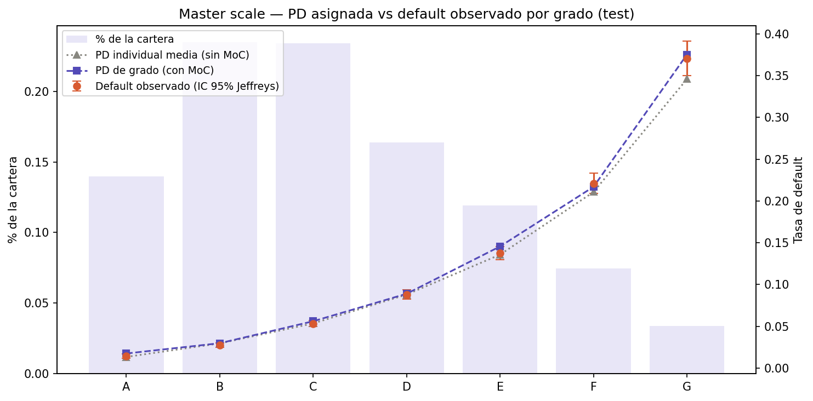
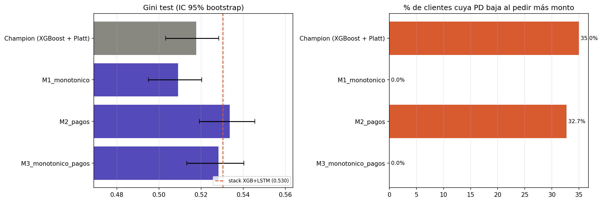

# Home Credit — Validación de un Modelo de PD

> 🇬🇧 [English version](README.md) (versión principal)

Desarrollo y **validación** de un modelo de Probabilidad de Default (PD) para crédito al
consumo. El objetivo no es sólo entrenar un modelo, sino responder lo que preguntaría un
área de Model Risk:
- ¿ordena bien el riesgo?
- ¿sus probabilidades son PDs confiables?
- ¿dónde falla?
- ¿qué pasa bajo estrés?
- ¿trata distinto a ciertos grupos?
- ¿está en condiciones de usarse?

Marco de referencia: **SR 26-2** (Fed/OCC/FDIC, abril 2026), que reemplaza a SR 11-7 y
mantiene su estructura de validación.

> **Alcance.** Es un proyecto de portfolio sobre un dataset público de Kaggle. Las
> referencias regulatorias (SR 26-2, ECOA, EU AI Act, IFRS 9) guían qué se analiza, pero no
> implican una certificación de cumplimiento. El Model Card detalla qué está cubierto y qué no.

---

## Qué agrega este proyecto frente al proyecto típico con Home Credit

La mayoría de los trabajos públicos con este dataset están pensados para el leaderboard de
Kaggle. El patrón es unir las 7 tablas, generar miles de features, tunear ensembles de
LightGBM y reportar AUC; las mejores soluciones rondan 0,79–0,80. Este proyecto **no compite
en ese eje**: usa sólo `application_train` más el historial de cuotas, y llega a un AUC de
0,76 (Gini 0,53 con el mejor challenger). Lo que agrega es la **capa de validación**, lo que
un banco necesita antes de usar un modelo.

| Proyecto típico | Este proyecto |
|---|---|
| Reporta AUC en un test que muchas veces también se usó para early stopping o para elegir el modelo | Split sin leakage: fit / validación / calibración / test. El test se usa una sola vez. |
| El score se trata como si fuera una probabilidad | Muestra que el score crudo **no** es una PD (38,8% vs 8,1% real), lo calibra y mide la calibración (ECE, calibration-in-the-large) |
| — | **Backtest por grado de rating** con test de Jeffreys y semáforo, para controlar las falsas alarmas por comparaciones múltiples |
| — | Encuentra **subestimación en el grado de mayor riesgo** y la remedia con un **margen de conservadurismo** estimado fuera de muestra, con el antes y el después |
| Umbral 0,5 o el que maximiza F1 | **Cutoff económico** `PD* = r/(r+LGD)` por mercado, contrastado con la curva de ganancia empírica |
| Fairness, si aparece, como un único DIR | DPD, DIR y equalized odds con la regla de decisión real, más un **análisis de proxies**: el sesgo por edad viaja por los scores de bureau (corr. 0,60), mostrado por tres caminos. Además documenta el **trade-off de calibración por grupo** (género). |
| — | **Stress test en pérdida esperada**, con shocks sobre variables crudas (no sobre features estandarizadas) |
| — | **Test de monotonía** (pedir más plata bajaba la PD en ~35% de los clientes) y un **challenger monotónico** que lo resuelve |
| Comparación de modelos por AUC puntual | Champion vs challengers con **IC de bootstrap pareado**. Variables simples de pagos igualan a un LSTM con mucha menos complejidad. |
| — | Artefactos de gobierno generados desde los outputs: **informe de validación** con hallazgos por severidad, **Model Card**, ADRs y estado en tres niveles (aprobado / con condiciones / no aprobado) |
| Resultados presentados como definitivos | **Iterativo y autocrítico:** la v1.0 no pasó la validación y se remedió en la v1.1. Los errores encontrados están documentados más abajo. |

---

## Resultado de la validación: **APROBADO CON CONDICIONES**

La validación es iterativa:
- **v1.0 — no aprobado:** la PD individual subestimaba el grado de mayor riesgo.
- **v1.1 — remediado:** se agregó una PD de grado con margen de conservadurismo (MoC), y
  todos los checks cuantitativos pasan.
- **Condiciones abiertas:**
  - fairness por edad (transmitido por los scores de bureau);
  - calibración desigual por género;
  - no-monotonía respecto del monto.

  Esta última la resuelve el **challenger recomendado (M3)**, que además mejora el Gini.

📄 **[Informe de validación (PDF, 2 páginas)](reports/validation_report.pdf)** ·
📋 **[Model Card](reports/model_cards/model_card.html)** ·
📊 **Dashboard:** `streamlit run streamlit-app/app.py`

| Check | Resultado | Umbral | Estado |
|---|---:|---|:---:|
| Gini (IC 95% bootstrap) | 0,518 (0,503–0,532) | ≥ 0,20 | ✅ |
| KS | 0,383 | ≥ 0,15 | ✅ |
| Lift vs benchmark logístico | +0,021 | > 0 | ✅ |
| ECE (PD calibrada) | 0,0045 | ≤ 0,02 | ✅ |
| Calibration-in-the-large | −1,6% | ±10% | ✅ |
| Backtest por grado (Jeffreys), PD de grado con MoC | todos los grados ok (sin MoC: G en rojo) | ningún grado con p < 1% | ✅ |
| PSI train/test | 0,0002 | ≤ 0,25 | ✅ * |
| Fairness (edad) | DPD 0,151, gap TPR 0,319 | DPD ≤ 0,10, gaps ≤ 0,10 | ❌ |

\* Split aleatorio: el PSI sólo confirma que train y test son homogéneos, no estabilidad en el tiempo.

---

## Hallazgos principales

### 1. El score de XGBoost no es una PD hasta que se calibra

`scale_pos_weight` compensa el desbalance (1:11), pero infla la escala de las probabilidades.
Platt scaling, ajustado sobre un split que el modelo no vio, corrige la escala sin cambiar
el orden.

| | PD media | Default real | ECE | Brier |
|---|---:|---:|---:|---:|
| Score crudo | 38,8% | 8,07% | 0,308 | 0,182 |
| PD calibrada | 7,9% | 8,07% | 0,005 | 0,068 |

Usar el score crudo como si fuera PD tiene un costo concreto: con el cutoff de USA aprueba
sólo al 23% de las solicitudes y **la ganancia cae a un tercio** (notebook 02).

### 2. Backtest por grado: la cola de alto riesgo se subestima → margen de conservadurismo



| Grado | Rango PD | % cartera | PD asignada | Default real | Jeffreys p | Resultado |
|---|---|---:|---:|---:|---:|---|
| A | 0–2% | 14,0% | 1,3% | 1,4% | 0,21 | ok |
| B | 2–4% | 23,5% | 3,0% | 2,7% | 0,95 | ok |
| C | 4–7% | 23,4% | 5,4% | 5,3% | 0,58 | ok |
| D | 7–11% | 16,4% | 8,8% | 8,8% | 0,50 | ok |
| E | 11–17% | 11,9% | 13,6% | 13,8% | 0,33 | ok |
| F | 17–27% | 7,5% | 21,1% | 22,1% | 0,047 | 🟠 alerta |
| G | ≥ 27% | 3,4% | 34,6% | 37,0% | 0,0098 | 🔴 subestima |

Con la PD individual el grado G queda en rojo. La calibración isotónica tampoco lo corrige,
y los challengers tienen el mismo problema: es una limitación de la cola con estos datos.
Subestimar el riesgo más alto es el error grave, porque deja provisiones insuficientes.

**Remediación (v1.1, [ADR 0007](docs/decisions/0007-pd-de-grado-con-moc.md)).** Se separan
los usos, como en los esquemas IRB:
- la **PD individual** ordena y decide;
- para pérdida esperada y provisiones, cada grado usa una **PD de grado** = máx(PD media,
  percentil 75 de Jeffreys del default observado en el split de validación).

| Grado | PD media | PD de grado (con MoC) | Default real (test) | Jeffreys p (antes → después) |
|---|---:|---:|---:|---|
| E | 13,6% | 14,6% | 13,8% | 0,33 → 0,98 |
| F | 21,1% | 21,7% | 22,1% | 0,047 🟠 → 0,26 ✅ |
| G | 34,6% | 37,5% | 37,0% | 0,0098 🔴 → 0,68 ✅ |

La pérdida esperada sube un 5,2% y el Gini no cambia. El semáforo (rojo con p < 1%, ámbar con
p < 5%) evita falsas alarmas: con 7 grados al 5%, la probabilidad de al menos una ronda el
30% ([ADR 0006](docs/decisions/0006-semaforo-master-scale.md)).

### 3. Ordenamiento y decisión

- **Deciles:** el default va de **1,3% en D1 a 27,5% en D10**. El 10% de mayor PD concentra
  el 34% de los defaults, y el 30% superior, el 65%.
- **Regla de decisión:** rechazar si `PD ≥ r/(r+LGD)`, el break-even de un préstamo a un
  período. Con los supuestos de USA (r = 11,5%, LGD = 45%) el cutoff es **20,35%**:
  - aprobación: 92,6%;
  - default entre aprobados: 6,3% (contra 30,7% entre rechazados).
- **Benchmarks:**

  | Modelo | Gini test |
  |---|---:|
  | **XGBoost + Platt** | **0,518** |
  | Regresión logística (mismas features) | 0,496 |
  | Scorecard WoE/IV, 14 variables, puntos PDO 20 | 0,482 |

  La ganancia de XGBoost sobre un scorecard tradicional es de ~3,6 puntos de Gini. Es un
  dato para la discusión de interpretabilidad vs performance.

### 4. Stress test: muy sensible al bureau, poco al ingreso

Los shocks se aplican sobre las variables crudas, se recalculan los ratios y se re-estima la
PD calibrada. La pérdida esperada es PD de grado × LGD × monto.

| Escenario | PD media | Δ pérdida esperada | Δ aprobación |
|---|---:|---:|---:|
| Base | 7,9% | — | — |
| Ingreso real −25% | 8,1% | +1,1% | −0,3 pp |
| Ingreso real −40% | 8,2% | +2,2% | −0,5 pp |
| Scores de bureau −20% | 11,1% | **+40,5%** | −5,2 pp |
| Recesión combinada | 10,7% | +34,2% | −4,8 pp |

El modelo casi no reacciona a caídas de ingreso: lo que mueve la PD son los scores
externos. Es coherente con el EDA, pero es un punto ciego si el shock llega primero por el
ingreso y después por el bureau.

### 5. Fairness: el canal es el bureau, no la variable edad

Con la regla de decisión real:
- **Género** (no es feature del modelo): aprobación F 94,1% vs M 89,7%, DIR 0,954. ✅
- **Edad** (sí es feature):
  - aprobación de <25: 83,4%; de >55: 98,6% (DIR 0,847);
  - brecha de TPR entre grupos: 0,32. ❌

El EDA muestra que `EXT_SOURCE_1` tiene una **correlación de 0,60 con la edad**, y SHAP sobre
los rechazos incorrectos muestra que los empujan los EXT_SOURCE, no `age_years`. Sacar la
edad del modelo cambiaría poco: es un caso de variable *proxy*. Decidir si es aceptable es
una cuestión de negocio y legal ([ADR 0004](docs/decisions/0004-atributos-protegidos.md)).

### 6. Robustez (notebook 04)

- **Ruido de ±5% en los inputs:** la decisión cambia en el 2% de los casos, y casi todos están
  a menos de 3 pp del cutoff. Una banda de revisión manual de ±3 pp cubriría el 5% de las
  solicitudes.
- **No-monotonía:** en el **~35% de los clientes, pedir más monto baja la PD**. El modelo
  aprendió una correlación de selección, y por eso se podría "jugar". Lo resuelven los
  challengers M1 y M3 (punto 10).
- **Counterfactual accionable:** el 58% de los rechazados se aprobaría pidiendo hasta la mitad del monto.

### 7. Segmentos débiles

| Segmento | Gini | vs global (0,518) |
|---|---:|---:|
| Edad > 55 | 0,422 | −0,10 |
| Pensionados | 0,445 | −0,07 |
| Edad < 25 | 0,464 | −0,05 |

### 8. Deep learning: sólo suma donde ve información nueva (notebook 06)

| Modelo | Gini test | Decisión |
|---|---:|---|
| Red neuronal tabular (MLP) | 0,508 | Descartada: no supera a XGBoost y sobreajusta después de la epoch 8 |
| LSTM sobre el historial de pagos | 0,187 | Sola no sirve (usa 2 variables por cuota) |
| Stack XGBoost + LSTM | 0,530 | Demuestra que la señal es incremental (+0,013, IC 95% [+0,008; +0,016]); lo reemplaza M3, que es más simple |
| Autoencoder (detector de atípicos) | — | Descartado: los "atípicos" defaultean 1,08x, casi igual que el resto |

Ninguna red supera a XGBoost con las mismas features. La secuencia de pagos de créditos
anteriores sí aporta información que `application_train` no tiene. Es la mejora más grande
del proyecto, y coincide con el diagnóstico del análisis de errores: falta información de
comportamiento.

### 9. Validación avanzada (notebook 07)

- **Calibración por género:** con el género fuera del modelo, la PD **subestima a los hombres
  (−9,6%) y sobreestima a las mujeres (+4,4%)**. Es el trade-off entre *fairness through
  unawareness* y calibración por grupo; queda documentado como decisión de política.
- **Isotónica vs Platt:** la isotónica tampoco corrige el grado G. El problema no es la forma
  de la calibración, así que la recomendación es un margen de conservadurismo en F–G.
- **MC Dropout:** en el 5% de clientes más incierto el Gini de XGBoost cae a 0,32 (0,52 en el
  resto). Es un criterio útil para revisión manual.
- **Validación cruzada:** Gini 0,513 ± 0,002 en 5 folds.
- **Dependencia parcial:** con el bureau fijo, la edad *no* penaliza a los jóvenes (la curva
  tiene forma de U invertida, con pico a los 39). Es la tercera evidencia de que el canal del
  sesgo por edad son los scores externos.
- **Concentración sectorial:** HHI 0,137. Si se duplica la PD del sector principal (28% de la
  exposición), la pérdida esperada sube un 31%.

### 10. Challengers: monotónico + historial de pagos ([ADR 0008](docs/decisions/0008-challengers.md))



| Modelo | Gini test | Δ vs champion (IC 95% pareado) | Monotonía* | Grado en rojo (sin / con MoC) |
|---|---:|---|---:|---|
| Champion (XGBoost + Platt) | 0,518 | — | 35% | G / — |
| M1 monotónico | 0,509 | −0,009 [−0,012; −0,005] | **0%** | G / — |
| M2 + variables de pagos | **0,534** | +0,016 [+0,011; +0,021] | 33% | G / — |
| **M3 monotónico + pagos** | **0,528** | **+0,011 [+0,005; +0,016]** | **0%** | G / — |
| *Stack XGBoost + LSTM (notebook 06)* | *0,530* | *+0,013* | — | — |

\* % de clientes cuya PD baja al pedir más monto (escalando monto, cuota y valor del bien).

- **La monotonía cuesta poco:** entre 0,5 y 0,9 puntos de Gini, y elimina la posibilidad de
  "jugar" con el monto.
- **Variables agregadas simples del historial de pagos** (atrasos, impagos, pagos parciales,
  últimos 12 meses) **igualan o superan al LSTM**, sin red recurrente.
- **M3 es el challenger recomendado:** mejora significativa, monótono, calibrado (ECE 0,004),
  backtest ok con MoC y fairness similar al champion. Antes de promoverlo falta la validación
  completa y llevar las variables de pagos a la API.

---

## Qué cambió respecto de la primera versión

El proyecto se re-validó a sí mismo. Estos errores se encontraron y se corrigieron:

| Problema | Impacto | Corrección |
|---|---|---|
| Early stopping y selección del champion sobre el **test set** | Métricas optimistas | Split fit / validación / calibración ([ADR 0001](docs/decisions/0001-esquema-de-splits.md)) |
| Stress test multiplicaba features **estandarizadas** (z-score × 0,75 ≠ ingreso −25%) | Resultado sin sentido (Δ = 0,0000) | Shocks sobre variables crudas, medidos en PD y pérdida esperada |
| "SR 11-7 PASS" ignoraba la calibración fallida | Aprobación incorrecta | La calibración y el backtest por grado entran al criterio |
| Threshold "óptimo" 0,725 en todos los mercados | Era el borde de la grilla | Cutoff analítico por break-even sobre PD calibrada |
| "Backtesting temporal" ordenado por `DAYS_BIRTH` (edad) y aplicado a un DataFrame sin reordenar | Ventanas aleatorias | Validación cruzada; se documenta que Home Credit no permite out-of-time |
| API `/predict` siempre devolvía 500 (faltaban ~23 columnas) | API inutilizable | Schema completo + tests de integración |
| Dashboard con datos sintéticos y "PASS" hardcodeados | Resultados no reales | Una sola app que lee sólo los outputs del pipeline |
| GNN con aristas aleatorias | No medía ningún contagio | Reemplazado por un análisis de concentración sectorial con datos reales |
| El patrón `models/` del `.gitignore` también excluía `src/models/` | El código del modelo no se habría publicado | Patrones anclados a la raíz |
| Grado G subestimado (v1.0) | Provisiones insuficientes en la cola | PD de grado con MoC (v1.1) |
| PD no monótona en el monto | Modelo "jugable" | Challenger monotónico M3 |

---

## Estructura

```
homecredit-model-validation/
├── configs/credit_policy.json       # Supuestos de negocio: tasas, LGD, master scale, umbrales
├── src/
│   ├── data/ingest.py               # Ingesta, data quality, features derivadas, split
│   ├── features/build.py            # Imputación + indicadores de missing + one-hot
│   ├── models/
│   │   ├── train.py                 # Benchmark logístico vs XGBoost + calibración Platt
│   │   ├── calibration.py           # Platt scaling sobre el logit
│   │   ├── pd_model.py              # PDScorer: datos crudos → PD calibrada / PD de grado
│   │   ├── moc.py                   # PD de grado con margen de conservadurismo
│   │   ├── challengers.py           # M1 monotónico, M2 pagos, M3 ambos
│   │   └── scorecard.py             # Scorecard WoE/IV con puntos (PDO)
│   ├── validation/
│   │   ├── model_validation.py      # Discriminación, calibración, PSI, stress, sensibilidad, segmentos
│   │   ├── master_scale.py          # Grados de rating + tests binomial / Jeffreys
│   │   └── explain.py               # SHAP
│   ├── governance/
│   │   ├── fairness.py              # DPD, DIR, equalized odds, AUC por grupo
│   │   ├── model_card.py            # Model Card HTML/JSON generado desde los reportes
│   │   ├── status.py                # Estado: aprobado / con condiciones / no aprobado
│   │   └── validation_report.py     # Informe de validación PDF
│   ├── monitoring/baseline.py       # Baseline y chequeo de drift (PSI)
│   └── api/main.py                  # FastAPI: PD, grado, PD de grado, decisión, pérdida esperada, SHAP
├── notebooks/                       # 01 EDA → 07 validación avanzada (ver abajo)
├── streamlit-app/app.py             # Dashboard ES/EN
├── docs/decisions/                  # ADRs: decisiones de diseño
├── docs/validation_findings.json    # Hallazgos de las notebooks que toma el informe
├── tests/                           # 27 tests (métricas, master scale, MoC, scorecard, API)
├── docker/                          # API + dashboard + MLflow
└── run_all.py
```

## Notebooks

| # | Notebook | Contenido |
|---|---|---|
| 01 | [EDA](notebooks/01_eda.ipynb) | Desbalance, missing informativos, edad como *proxy* en los scores de bureau |
| 02 | [Cutoff de decisión](notebooks/02_threshold_analysis.ipynb) | Break-even por mercado (AR, US, BR, CO) y costo del fairness |
| 03 | [Análisis de errores](notebooks/03_error_analysis.ipynb) | Falsos negativos/positivos de alta confianza, SHAP, segmentos |
| 04 | [Robustez](notebooks/04_robustez_counterfactuals.ipynb) | Ruido en inputs, monotonía del monto, monto máximo aprobable |
| 05 | [Ciclo de vida](notebooks/05_lifecycle_simulation.ipynb) | Simulación sintética de drift y criterios de monitoreo/retiro |
| 06 | [Deep learning](notebooks/06_deep_learning.ipynb) | MLP, LSTM sobre pagos, stacking, autoencoder |
| 07 | [Validación avanzada](notebooks/07_advanced_validation.ipynb) | Calibración por segmento, isotónica vs Platt, MC Dropout, CV, PDPs, concentración |

## Quickstart

```bash
python -m venv .venv
source .venv/bin/activate            # Windows: .venv\Scripts\activate
pip install -r requirements.txt      # notebooks: requirements-notebooks.txt

# Datos de Kaggle en data/raw/:
#   application_train.csv            (obligatorio)
#   installments_payments.csv        (challengers M2/M3 y notebook 06)
# https://www.kaggle.com/c/home-credit-default-risk/data

python run_all.py                    # pipeline completo (~15 min en CPU, reproducible)
pytest tests/ -v
uvicorn src.api.main:app --port 8000 # API → http://localhost:8000/docs
streamlit run streamlit-app/app.py   # dashboard
```

## Limitaciones

- **Sin dimensión temporal:** Home Credit no trae fecha de originación. No hay validación
  out-of-time ni análisis de cosechas reales.
- **Target:** marca dificultades de pago. No equivale a una definición regulatoria de default
  ni tiene un horizonte de 12 meses, así que no es directamente usable para IFRS 9.
- **Sin validación independiente:** el modelo lo desarrolló y lo validó la misma persona.
- **Datos:** sólo `application_train` más `installments_payments`. `bureau` y
  `previous_application`, las fuentes extra con más señal en las soluciones de Kaggle, son el
  próximo paso natural.
- **Supuestos de negocio:** las tasas y LGD por mercado son supuestos de ejercicio
  (`configs/credit_policy.json`) y no descuentan fondeo ni inflación.

## Stack

Python · XGBoost · scikit-learn · PyTorch · SHAP · MLflow · FastAPI · Streamlit · pytest · Docker · GitHub Actions
